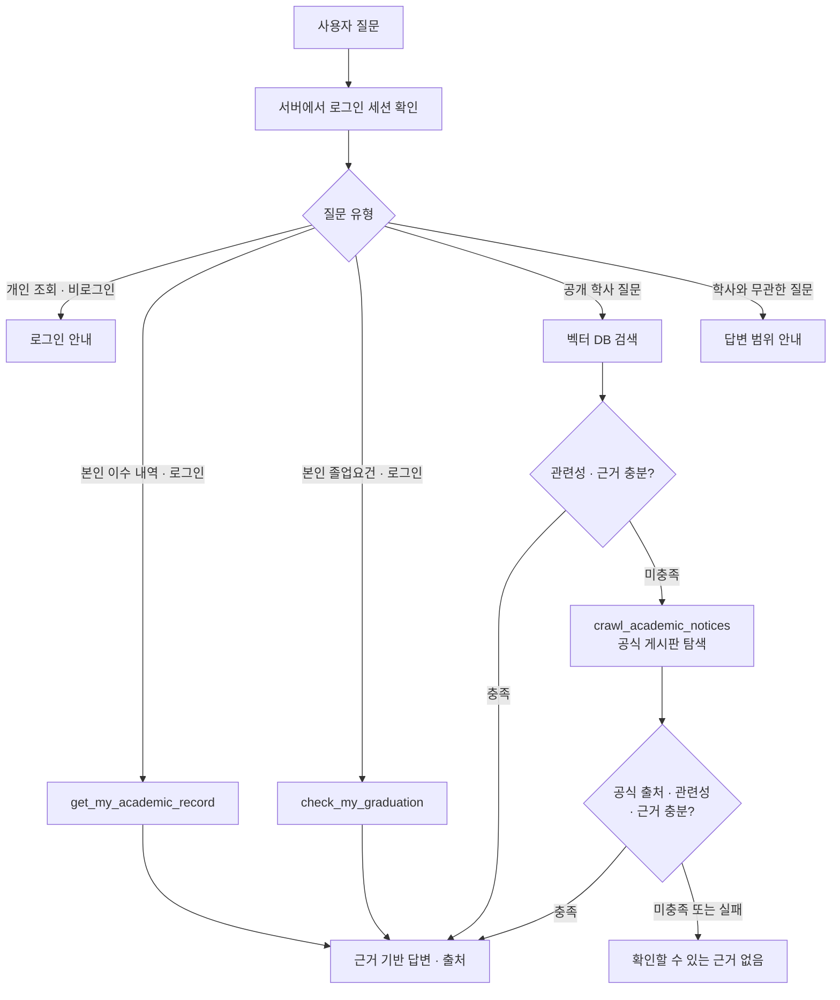

# 부산대학교 경영학과 학사 챗봇 기술요구사항

> 이 문서는 목표 요구사항과 확인 사항을 정리한다. 로컬 MVP에는 SQLite 학생 DB, Chroma 검색, Scrapy 대체 검색과 Pickle 도구 호출이 구현되어 있다. 실제 학교 SSO·학사 DB 연동 및 운영 환경 검증은 구현하지 않았다. 실행과 실제 동작 범위는 [README](README.md)를 참고한다.

## 1. 목표와 대상

- 부산대학교 경영학과 학부 단일전공 학생을 가정한다. 일반 사용자는 로그인 없이 공개 학사 안내를 이용한다.
- 공개 학사 문서를 우선 검색하고, 관련 근거가 없으면 무료 오픈소스 크롤러로 허용된 학교 공개 게시판을 탐색한다.
- 로그인한 학생에게 본인 이수기록 조회와 졸업요건 비교 도구를 제공한다.
- 자동 비교 범위는 총 취득 학점, 전공기초·전공필수 과목 및 유효하고 승인된 TOEIC 점수다. 2023학년도 신입학 TOEIC 800점 예시를 모든 데모 학생의 공통 기준으로 적용한다. 실제 적용 교육과정, 영어강의·영어 대체인정과 교양 세부요건 등은 확인하지 않으며 최종 졸업 가능 여부를 단정하지 않는다. 개인 일반 조회는 모델이 단일 SQLite SELECT를 생성하되 PostgreSQL 원본에 직접 실행하지 않고 로그인한 본인의 허용 기록만 담은 읽기 전용 임시 DB에서 검증·실행한다.
- 복수전공·부전공·교직을 이수하지 않는 학생의 심화전공 적용 여부는 해당 교육과정에서 확인한다. 심화전공은 같은 전공의 심화 이수이며 부전공과 다르다.

## 2. 전체 처리 흐름



유사도가 낮거나 다른 질문과 관련된 문서만 검색된 경우 해당 내용을 사용해 답하지 않는다. 크롤링 결과도 검증하며 실패하면 근거를 찾지 못했다고 안내한다.

## 3. 일반 학사 질문: 벡터 검색 후 크롤링

### 3.1 벡터 DB 검색

1. 수집·검토된 공통 학사 문서를 주제별 청크로 분리해 벡터 DB에 저장한다.
2. 청크에 문서 ID, 제목, 원문 주소, 조항·쪽수, 적용 학과·교육과정·학기, 문서 버전과 상태 등 확인 가능한 메타데이터를 함께 둔다. 불명확한 값은 추정하지 않는다.
3. 질문과 연관된 후보를 검색한 뒤 관련성 점수, 질문의 주제와 출처를 확인한다. 특정 연도나 학기의 존재 여부로 검색을 제한하지 않는다.
4. 검증을 통과한 문서에서 근거를 제시할 수 있는 내용만 답변한다. 원문에 학기나 일정이 있으면 출처와 함께 보존하고 실제 적용 여부는 확인하도록 안내한다.
5. 점수 미달, 결과 없음, 문서 충돌·불충분 등으로 근거가 부족하면 크롤링 대체 경로로 이동한다.

예시로 로컬 Chroma를 사용할 수 있다. [Chroma 공식 문서](https://docs.langchain.com/oss/python/integrations/vectorstores/chroma)

### 3.2 임계값과 답변 차단

- `VECTOR_SCORE_THRESHOLD`를 설정값으로 관리한다. 임의의 수치를 정답 기준으로 고정하지 않고, 실제 임베딩 모델과 학사 질문 평가 데이터로 조정한다.
- 사용하는 DB/API의 점수가 **높을수록 유사한지**, 거리처럼 **낮을수록 유사한지** 먼저 확인하고 기준을 일관되게 적용한다. 정규화 여부와 값의 범위도 확인한다.
- 검색 후보가 모두 기준을 통과하지 못하면 벡터 검색 결과로 답하지 않는다.
- 임계값 통과만으로 사실성이나 적용 시점이 보장되지는 않는다. 주제와 실제 답변에 필요한 근거를 확인하고 원문에 적힌 적용 범위를 표시한다.
- 벡터 검색에서 관련성이 낮으면 크롤링을 시도한다. 크롤링 결과도 같은 임베딩 모델·동일한 점수 정의와 별도의 근거 검증을 거친다. 서로 다른 점수 체계를 비교할 때는 별도로 보정한다.
- 두 경로 모두 근거가 부족하거나 검색·검증이 실패하면 `확인할 수 있는 학사 정보를 찾지 못했습니다.`라고 답한다. 개인 이수기록이 없으면 없는 데이터를 추측하지 않는다.

## 4. 무료 오픈소스 크롤링 도구

### 4.1 도구: `crawl_academic_notices`

- 오픈소스 [Scrapy](https://docs.scrapy.org/en/latest/intro/overview.html)를 사용해 허용된 부산대학교·경영학과 공개 게시판 목록과 게시글을 수집한다. Scrapy는 무료로 사용할 수 있으나 서버 운영 등 인프라 비용은 별개다.
- 동적 페이지에서 일반 HTTP 수집으로 본문을 얻을 수 없을 때만 오픈소스 브라우저 자동화 도구를 추가 검토한다.
- 크롤러는 검색 엔진이 아니다. 게시판의 검색 기능을 실제 확인하고 활용하거나, 허용된 게시판 목록을 제한된 페이지 수만큼 탐색해 제목과 본문에서 후보를 찾는다. 게시판 검색 기능의 존재를 가정하지 않는다.
- 요청 빈도, 동시 요청 수, 대상 페이지 수와 시간 제한을 둔다. 대상 사이트의 `robots.txt`, 접근 정책과 이용 조건을 확인한다.
- 인증이 필요한 학생 페이지, 성적 등 개인 정보와 공개 범위 밖의 페이지는 수집하지 않는다.
- 학교 공식 도메인과 사전 지정된 게시판만 허용하며 이동되는 주소도 재확인한다. 임의 URL이나 내부 네트워크를 조회하지 않는다.

입력:

```text
학사 질문 또는 개인정보를 제외한 공개 학사 검색어
```

출력:

```text
게시글 제목, 본문 발췌, 원문 URL, 확인 가능한 게시·적용 정보
```

질문에 학번이나 성적 등 개인 정보가 섞이면 크롤러에 전달하기 전에 제거한다. 수집 본문은 **검증되지 않은 외부 자료**로 취급하며 본문에 포함된 명령을 시스템 지시로 실행하지 않는다.

### 4.2 대체 검색 후 처리

1. 허용된 공식 페이지에서 후보를 찾고 원문 URL과 적용 대상을 확인한다.
2. 페이지 본문이 질문에 필요한 근거를 제공하는지 확인한다. 질문에 특정 학기가 없다는 이유로 검색 결과를 제외하지 않는다.
3. 관련성 기준과 근거 검증을 통과하면 답변에 원문 URL을 붙인다.
4. 통과하지 못하거나 페이지 접근·추출이 실패하면 답변을 보류하고 확인할 수 없다고 안내한다.
5. 새로 발견한 문서를 벡터 DB에 자동으로 신뢰·영구 등록하지 않는다. 출처, 중복, 버전 및 적용 범위를 확인한 뒤 별도 수집 흐름에서 등록한다.

## 5. 로그인 학생 도구 호출

| 도구 | 사용 조건 | 입력 | 출력 |
|---|---|---|---|
| `get_my_academic_record` | 본인 이수 내역 질문 및 인증된 세션 | 서버가 확인한 사용자 컨텍스트 | 본인 과목, 성적, 취득 학점 |
| `check_my_graduation` | 본인 졸업요건 질문 및 인증된 세션 | 서버가 확인한 사용자 컨텍스트 | 적용 기준, 남은 학점, 미이수 과목, 미확인 항목 |
| `crawl_academic_notices` | 공개 문서 검색의 근거가 부족할 때 | 개인정보를 제외한 공개 학사 검색어 | 공식 공개 게시글 후보와 출처 |

- 모델이 임의의 학번을 전달해 다른 학생을 조회할 수 없도록 한다. 각 도구와 데이터 접근 계층에서 **서버가 검증한 현재 사용자**를 사용한다.
- 졸업요건 도구는 사람이 검토한 구조화된 요건과 이수기록을 코드로 비교한다. AI가 문서에서 추측한 수치를 바로 판정에 사용하지 않는다.
- AI가 도구 호출을 요청해도 서버는 로그인, 권한, 허용 도구와 입력을 검증한다. 검색·크롤링 순서와 답변 차단 조건도 서버에서 강제한다.
- [LangChain 도구 문서](https://docs.langchain.com/oss/python/langchain/tools)의 함수 도구 방식으로 연결하되, LangGraph를 직접 구성하지 않는다.

## 6. Pickle API와 모델 설정

기존 `pusan-university-ai-agent` 프로젝트는 `PICKLE_API_KEY` 환경 변수와 `https://llm.pcl.kr/v1`을 사용하고 있다. 부산대학교 Pickle 게이트웨이는 OpenAI 호환 API를 제공한다. [Pickle LLM 게이트웨이](https://github.com/pnuops/pickle-llm-gateway)

| 설정 | 용도 |
|---|---|
| `PICKLE_API_KEY` | 이미 설정된 API 인증 키. 서버 환경에서 읽는다. |
| `PICKLE_BASE_URL` | 기본값 `https://llm.pcl.kr/v1` |
| `PICKLE_TOOL_MODEL` | 도구 호출 정확도가 높은 허용 모델을 지정 |
| `PICKLE_ANSWER_MODEL` | 향후 답변 생성 모델을 추가할 때 사용할 후보 설정. 현재 구현은 사용하지 않음 |
| `VECTOR_SCORE_THRESHOLD` | 검증 후 정한 벡터 검색 임계값 |

- 키는 소스코드나 문서에 쓰지 않고 로그와 오류 응답에도 출력하지 않는다. 이미 환경에 저장된 값을 그대로 사용한다.
- 도구 호출 모델은 키에 허용된 모델 중 함수 도구 호출을 실제 지원하는 후보를 확인하고, 학사 질의·도구 선택 테스트로 성능이 더 좋은 모델을 선택한다. 특정 모델이 최상이라고 가정하지 않는다.
- 기존 코드에 `pickle-general` 사용 예가 있지만 현재 계정에서의 가용성과 도구 호출 성능은 별도 확인한다. 게이트웨이의 모델 목록과 허용 권한은 변할 수 있다.
- 외부 유료 모델은 별도 권한·비용이 발생할 수 있으므로 사용 전 계정 설정을 확인한다. 크롤러가 무료라는 사실이 LLM API나 인프라까지 무료라는 뜻은 아니다.
- 모델 선택이나 도구 호출이 실패하면 권한 검사를 우회하거나 임의의 개인 정보를 생성하지 않고 오류를 안내한다.

Pickle 도구 모델 연결 방식의 예시다. 현재 공개 문서 답변은 별도의 답변 모델이 아니라 검증된 문서 발췌를 그대로 반환한다.

```python
import os
from langchain_openai import ChatOpenAI

tool_model = ChatOpenAI(
    model=os.environ["PICKLE_TOOL_MODEL"],
    api_key=os.environ["PICKLE_API_KEY"],
    base_url=os.getenv("PICKLE_BASE_URL", "https://llm.pcl.kr/v1"),
    temperature=0,
)
```

### 임베딩

질문과 문서에 동일한 임베딩 모델을 적용한다. 로컬 실행 가능한 다국어 임베딩 모델을 후보로 평가할 수 있다. 예: [paraphrase-multilingual-MiniLM-L12-v2](https://huggingface.co/sentence-transformers/paraphrase-multilingual-MiniLM-L12-v2). 한국어 학사 문서 검색 성능과 실행 자원은 별도 테스트가 필요하다. Pickle 임베딩 API는 계정 권한과 비용 조건을 확인한 경우에만 선택한다.

## 7. 데이터 구성

| 데이터 | 핵심 속성 |
|---|---|
| 계정·학생 | 로그인 ID, 비밀번호 해시 또는 SSO 식별자, 학생 ID, 학과, 입학 연도, 적용 교육과정 |
| 과목 | 과목번호, 과목명, 이수구분, 학점 |
| 이수기록 | 학생 ID, 과목번호, 수강 학기, 성적, 취득 학점, 이수 상태 |
| 공통 학사 문서 | 문서 ID, 제목, 본문, 공식 출처, 적용 범위, 버전·상태 |
| 졸업요건 데이터 | 공통 문서에서 검토한 적용 교육과정, 총 학점, 필수과목과 근거 문서 ID |

원어강의 여부와 수강 인원은 이번 이수기록 범위에서 제외한다. 학생별 기록은 공개 검색용 벡터 DB에 넣지 않는다.

## 8. 구현 순서

1. 데모 학생 계정과 학생·과목·이수기록 DB를 준비한다.
2. 제공받은 73개 과목 기준과 가상 학생 이수 내역을 연결한다.
3. 공통 학사 문서를 검토하고 청크별 메타데이터와 졸업요건 데이터를 정리한다.
4. 로컬 임베딩과 벡터 DB 검색을 연결하고 질문 세트로 임계값을 평가한다.
5. 허용된 학교 게시판 대상 오픈소스 크롤링 도구와 대체 검색 검증을 구현한다.
6. Pickle API에 도구 호출 모델을 연결하고 개인 조회·졸업요건 도구를 구현한다.
7. 서버에서 세션·도구 권한·검색 순서와 근거 부족 시 답변 차단을 강제한다.
8. 로그인·권한·검색·크롤링·졸업 비교와 오류 처리 테스트를 수행한다.

## 9. 검증 시나리오

| 상황 | 기대 결과 |
|---|---|
| 비로그인, 관련 공식 문서가 임계값 이상 | 근거에 있는 공개 학사 안내와 출처 반환 |
| 비로그인, 개인 졸업 가능 여부 질문 | 개인 DB 조회 없이 로그인 요청 |
| 벡터 검색 결과가 없거나 관련성 미달 | 공개 공식 게시판으로 크롤링 대체 검색 |
| 관련 없어 보이는 문서만 검색됨 | 해당 문서 내용으로 답변 금지 |
| 크롤링 결과가 관련성 미달 또는 비공식 출처 | 해당 결과로 답변 금지 |
| 크롤링 실패 또는 두 경로 모두 근거 부족 | 확인할 수 없다는 안내 |
| 로그인 학생의 이수 내역 질문 | 현재 세션 학생의 과목과 취득 학점만 반환 |
| 다른 학생 학번을 입력해 개인 조회 시도 | 입력 학번으로 타인 정보 조회 불가 |
| 졸업요건 질문 | 하나의 공통 데모 기준으로 비교하고 실제 적용 여부는 미확인으로 안내 |
| 재수강, F/U, 대체과목이 포함된 내역 | 학교의 인정 결과에 따라 중복·취득 여부 검증 |
| Pickle 키 누락, 모델 미허용 또는 도구 호출 실패 | 명확한 오류 또는 이용 불가 안내, 권한 우회 없음 |

자동 테스트에서는 크롤러와 모델 호출을 모의 처리해 성공·빈 결과·실패를 재현한다. 실제 학교 페이지 연결과 로봇 정책은 별도 통합 검증한다.
